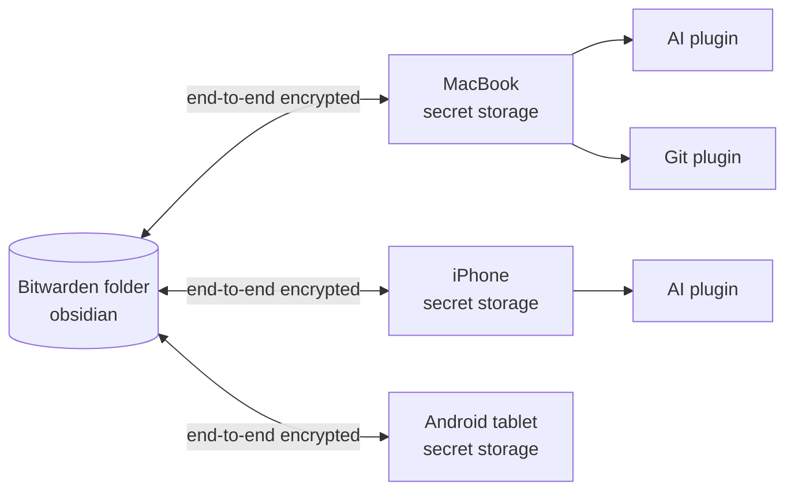

# Bitwarden Secrets for Obsidian

**Type an API key once. Have it on every device.**

Obsidian 1.11.4 gave plugins a proper keychain, `app.secretStorage`, so
your OpenAI key, GitHub token or Jira password no longer sit in plain text
in `data.json`. It also deliberately keeps that keychain on one device.
On every new laptop, phone or tablet you open the settings of every
plugin and paste every secret again.

This plugin puts those secrets in a folder of your Bitwarden vault and
keeps every device in sync with it, on desktop, iOS and Android. Your other
plugins don't change: they keep reading `app.secretStorage` as before.



## Why you might like it

- **Set up once, available everywhere.** Add a secret on one device and it
  shows up on the others after the next sync. Edit it in Bitwarden and the
  change reaches Obsidian. Edit it in Obsidian and it goes back to Bitwarden.
- **No changes for other plugins.** Any plugin that uses Obsidian's secret
  storage benefits right away.
- **Your password never leaves the device.** Everything is decrypted on the
  device, with the same cryptography as the official Bitwarden clients. The
  server only ever sees ciphertext.
- **It can't overwrite your edits by surprise.** A three-way merge tells
  "I edited this here" apart from "it changed in Bitwarden". Real conflicts
  are shown to you, and secrets are never displayed in the conflict dialog.
- **It stops instead of wiping your secrets.** Sync aborts instead of
  clearing anything when the folder disappears, is swapped for another
  folder, or would lose more than half of your secrets at once.
- **It keeps the rest of your items.** Usernames, URIs, notes, custom fields,
  attachments and password history in Bitwarden are left as they are.
- **Choose where each secret appears.** A secret can go to every vault, to
  one vault only, or to one device only.
- **Works with any Bitwarden server.** That includes bitwarden.com,
  bitwarden.eu and self-hosted Bitwarden or Vaultwarden. Tested against
  Vaultwarden, `rbw` and the official Bitwarden CLI.

## Quick start

1. **Get a personal API key.** In the Bitwarden web vault, open
   *Settings → Security → Keys → View API key*.
2. **Install the plugin.** It is not in the community store yet. Build it
   (see [Development](#development)), copy `main.js` and `manifest.json` into
   `<vault>/.obsidian/plugins/bitwarden-secrets/`, and enable it in
   *Settings → Community plugins*.
3. **Connect.** In the plugin settings, enter the server URL
   (`https://vault.bitwarden.com`, `https://vault.bitwarden.eu` or your own),
   your email, and the API key's `client_id` and `client_secret`.
4. **Unlock.** Run **Bitwarden Secrets: Unlock** and enter your master
   password. It only derives the decryption key on this device. The API key
   only authenticates.

That's it. Items already in the `obsidian` folder appear in secret storage.
To send an existing local secret up, run **Upload a secret to Bitwarden…**.
Nothing is uploaded unless you choose it.

## How Bitwarden items become secrets

Put **login** or **secure note** items in the Bitwarden folder (`obsidian`
by default):

| In Bitwarden | In Obsidian |
|---|---|
| Custom field `obsidian-id`, or else the item name | Secret id, e.g. `openai-api-key` (lowercase letters, digits and dashes) |
| Login password, or the secure note's text | Secret value |
| Optional custom field `obsidian-scope` | Where the secret appears: `global` (default, everywhere), `vault:<name>` (one vault), `device:<id>` (one device; the id is shown in the settings) |

## Sync rules

Each sync compares Bitwarden, this device, and what both looked like at the
last sync:

| Bitwarden | This device | Result |
|---|---|---|
| changed | unchanged | updated here |
| unchanged | changed | uploaded |
| changed | changed differently | conflict: you choose, or the configured policy decides |
| item trashed | unchanged | cleared here (set to empty, because secret storage cannot delete) |
| item unreadable (newer format, moved to an organization, renamed) | any | left alone and reported as skipped |
| new | a different value that was never synced | conflict, whatever the policy |

Sync runs after unlocking, every 10 minutes (configurable), when Obsidian
comes back to the foreground, and on **Sync now** or a click on the status
bar. A secret you edit while a sync is running is never overwritten.

## Security

- **Settings stay on this device.** Settings and sync state live in the
  vault's device-local storage, not in `data.json`. `data.json` is often
  synced or committed, and whoever can edit it must not be able to send your
  API key to their own server.
- **The API key is tied to its server.** If you change the server URL, you
  have to enter the key again.
- **Only authenticated encryption is accepted.** That means Bitwarden's
  AES-CBC + HMAC (type 2), with the MAC checked first. KDF parameters from
  the server are range-checked, so a server cannot weaken the KDF or set an
  absurd cost.
- **Be careful with "Remember unlock on this device".** Every installed
  plugin can read Obsidian's secret storage. That includes the API key and,
  with this option on, your account key. Together they decrypt your
  **whole** vault, not just this folder. Leave the option off unless you
  trust the device and every plugin on it.

The full threat model, the security review and its fixes are in
[`docs/design.md`](docs/design.md#9-security-model).

## Limitations

- Organization items and the newer COSE item encryption (type 7) are not
  supported. Such items are skipped and left untouched.
- On mobile, Obsidian has been reported to share secret storage across
  vaults
  ([forum](https://forum.obsidian.md/t/secretstorage-appears-to-be-shared-across-vaults-on-mobile-but-vault-scoped-on-desktop/117793)),
  so a `vault:` scope may not isolate secrets between vaults there.
- With a very expensive Argon2 setting (close to the 1 GiB maximum
  Bitwarden allows), unlocking can freeze a phone for a while.

## Development

```sh
npm install
npm run build              # typecheck + production bundle (main.js)
npm run check:bundle       # bundle may only require "obsidian", no Node globals
npm test                   # unit + multi-device sync tests (in-memory Bitwarden)
npm run test:browser       # the same suites in WebKit (≈ iOS) and Chromium (≈ Android)
npm run perf               # performance budgets (add :browser for WebKit/Chromium)

# Against a real server, cross-checked with rbw and the official Bitwarden CLI:
docker run -d --rm --name bw-secrets-it -p 127.0.0.1:18080:80 \
  -e SIGNUPS_ALLOWED=true -e LOGIN_RATELIMIT_MAX_BURST=1000 -e LOGIN_RATELIMIT_SECONDS=1 \
  -e I_REALLY_WANT_VOLATILE_STORAGE=true vaultwarden/server:latest
BW_IT_URL=http://127.0.0.1:18080 npm run test:integration
```

The crypto known-answer vectors in `test/fixtures/vectors.json` come from an
independent Python implementation, `test/fixtures/gen_vectors.py`. To
regenerate them:

```sh
uv run --no-project --with cryptography --with argon2-cffi python test/fixtures/gen_vectors.py
```

Architecture, the sync algorithm, test results and performance figures are
in [`docs/design.md`](docs/design.md).

## License

[MIT](LICENSE)
