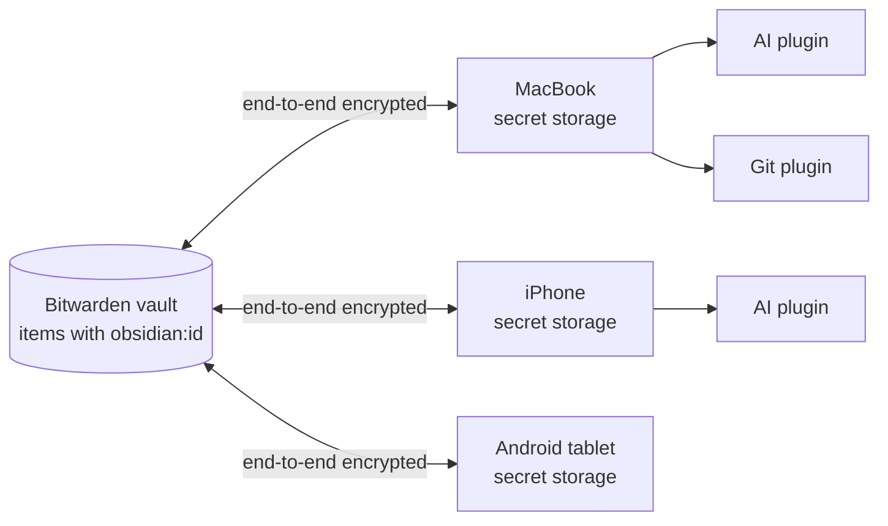

# Keychain Bitwarden for Obsidian

**Type an API key once. Have it on every device.**

Obsidian 1.11.4 gave plugins a proper keychain, `app.secretStorage`, so
your OpenAI key, GitHub token or Jira password no longer sit in plain text
in `data.json`. It also deliberately keeps that keychain on one device.
On every new laptop, phone or tablet you open the settings of every
plugin and paste every secret again.

This plugin keeps those secrets in your Bitwarden vault, on any item you
mark with an `obsidian:id` field, and keeps every device in sync with it, on desktop, iOS and Android. Your other
plugins don't change: they keep reading `app.secretStorage` as before.



## Why you might like it

- **Set up once, available everywhere.** Add a secret on one device and it
  shows up on the others within seconds. Edit it in Bitwarden and the
  change reaches Obsidian. Edit it in Obsidian and it goes back to Bitwarden.
- **No changes for other plugins.** Any plugin that uses Obsidian's secret
  storage benefits right away.
- **Your password never leaves the device.** Everything is decrypted on the
  device, with the same cryptography as the official Bitwarden clients. The
  server only ever sees ciphertext.
- **It can't overwrite your edits by surprise.** A three-way merge tells
  "I edited this here" apart from "it changed in Bitwarden". Real conflicts
  are shown to you, and secrets are never displayed in the conflict dialog.
- **It stops instead of wiping your secrets.** Sync aborts instead of
  clearing anything when it would lose half of your secrets or more at
  once, and an item that merely became unreadable is kept, not cleared.
- **Organize Bitwarden as you like.** Marked items are found anywhere in the
  vault, in any folder or none, so moving them around changes nothing.
- **It keeps the rest of your items.** Usernames, URIs, notes, custom fields,
  attachments and password history in Bitwarden are left as they are.
- **Choose where each secret appears.** A secret can go to every vault, to
  one vault only, or to one device only.
- **Share with your team.** Optionally, items of your Bitwarden
  organizations sync too, with the organization's permissions respected.
- **Unlocking never freezes Obsidian.** The key is derived in a background
  worker, so even the heaviest Argon2 settings leave the app responsive, and
  you can cancel by closing the dialog.
- **Works with any Bitwarden server.** That includes bitwarden.com,
  bitwarden.eu and self-hosted Bitwarden or Vaultwarden. Tested against
  Vaultwarden, `rbw` and the official Bitwarden CLI.
- **Ready for Bitwarden's newer encryption.** Accounts on the "v2" key
  format (XAES-256-GCM or XChaCha20-Poly1305, stored as COSE) work like any
  other, checked both ways against Bitwarden's own SDK.

## Quick start

1. **Get a personal API key.** In the Bitwarden web vault, open
   *Settings → Security → Keys → View API key*.
2. **Install the plugin.** It is not in the community store yet. Either add
   this repository in [BRAT](https://github.com/TfTHacker/obsidian42-brat),
   which also keeps it up to date, or download `main.js` and `manifest.json`
   from the latest release into
   `<vault>/.obsidian/plugins/keychain-bitwarden/`. Then enable it in
   *Settings → Community plugins*.
3. **Connect.** In the plugin settings, enter the server URL
   (`https://vault.bitwarden.com`, `https://vault.bitwarden.eu` or your own),
   your email, and the API key's `client_id` and `client_secret`.
4. **Unlock.** Run **Keychain Bitwarden: Unlock** and enter your master
   password. It only derives the decryption key on this device. The API key
   only authenticates.

That's it. Items carrying an `obsidian:id` field appear in secret storage.
To send an existing local secret up, run **Upload a secret to Bitwarden…**.
Nothing is uploaded unless you choose it.

## How Bitwarden items become secrets

The plugin scans the whole vault. A **login** or **secure note** item,
in any folder or none, becomes a secret once it has a custom field named
`obsidian:id`; every other item is ignored:

| In Bitwarden | In Obsidian |
|---|---|
| Custom field `obsidian:id` (required) | Secret id, e.g. `openai-api-key` (lowercase letters, digits and dashes) |
| Custom field `obsidian:password` if the item has one, else the notes when `obsidian:location` is `notes`, else the login password or the secure note's text | Secret value |
| Optional custom field `obsidian:scope` | Where the secret appears: `global` (default, everywhere), `vault:<name>` (one vault), `device:<id>` (one device; the id is shown in the settings) |

Bitwarden fits about 3,600 characters in a custom field. A longer secret
(a private key, a certificate) goes into the item's notes instead, marked
`obsidian:location` = `notes`, but only when the notes are empty or already
hold that secret: your own notes are never overwritten, and the edit is
reported as an error instead. A login password has the same limit; notes
take about twice as much. Items using `obsidian:encoding` (binary data)
are skipped and reported: secret storage holds text only.

`obsidian:password` lets a secret live next to an unrelated password, for
example an API token on the login of the site that issued it. Edits made in
Obsidian go back to where the value was read from, and the login password
is then left alone. Remove the `obsidian:id` field to stop syncing an item;
the secret is then cleared on your devices.

Secrets uploaded from Obsidian become secure notes in the **Folder for
uploads** (`obsidian` by default, created when needed; leave it empty for no
folder). The value goes into a hidden `obsidian:password` field, so the
note's text stays yours.

If two items carry the same id (for example after "Clone item"), a personal
item wins over an organization item, then the item created first. Every
device picks the same one, however the items are edited later.

### Organization items

Turn on **Sync organization items** to also sync the items of your
organizations that carry an `obsidian:id` field:

- Edits go back to the organization, encrypted with its key; the item stays
  in its organization and collections.
- Items you may only view are pulled, never pushed. Items whose password
  the organization hides from you are skipped.
- A personal item always wins over an organization item with the same id.
- An organization item that claims the id of a secret you already have
  (queued for upload, set locally, or synced from another item) is never
  written to, never replaces your value and is never linked to it silently,
  even with the same value: you are always asked, whatever the conflict
  policy. Keeping yours uploads it as a personal item.
- Nothing of yours is sent to an organization item until you agree, once
  per item, in the conflict dialog that names the organization, whatever
  the conflict policy. Pulling an item, even after you confirmed its claim,
  binds the id for pulls only; your first edit of it asks
  (`organization-push`). "Use the organization's" takes its value instead.
- New uploads are always personal items.

It is off by default: see [Security](#security) for why.

## Sync rules

Each sync compares Bitwarden, this device, and what both looked like at the
last sync:

| Bitwarden | This device | Result |
|---|---|---|
| changed | unchanged | updated here |
| unchanged | changed | uploaded |
| changed | changed differently | conflict: you choose, or the configured policy decides |
| item trashed, or its `obsidian:id` field removed | unchanged | cleared here (set to empty, because secret storage cannot delete) |
| item unreadable (newer format, moved to an organization, renamed) | any | left alone and reported as skipped |
| new | a different value that was never synced | conflict, whatever the policy |

Sync runs after unlocking, as soon as the server announces a change made
elsewhere (**Live updates**, on by default), every 10 minutes as a fallback
(configurable), when Obsidian comes back to the foreground, and on
**Sync now** or a click on the status bar. A secret you edit while a sync is
running is never overwritten.

## Security

- **Settings stay on this device.** Settings and sync state live in the
  vault's device-local storage, not in `data.json`. `data.json` is often
  synced or committed, and whoever can edit it must not be able to send your
  API key to their own server.
- **The API key is tied to its server.** If you change the server URL, the
  saved key is refused instead of sent, until you enter it again or change
  the URL back. It is not deleted, so a half-typed URL or a settings file
  synced from another device cannot cost you the key.
- **Only authenticated encryption is accepted.** That means Bitwarden's
  AES-CBC + HMAC (type 2, the MAC checked first) and its COSE format
  (type 7, XAES-256-GCM or XChaCha20-Poly1305). A COSE ciphertext must name
  the key it was made for and say what it holds, so it cannot be passed off
  as something else. KDF parameters from the server are range-checked, so a
  server cannot weaken the KDF or set an absurd cost.
- **Unmarked items stay encrypted.** To find the marked items the plugin
  decrypts the custom field *names* of every item; names, passwords, notes
  and field values of unmarked items are never decrypted. The marker is
  itself encrypted, so a server cannot turn one of your other items into a
  secret.
- **Organization items are opt-in for a reason.** Their key reaches you
  encrypted to your public key, which the server knows. So a compromised
  server, like anyone in the organization, can create marked organization
  items. Without the folder that used to stand in the way, any member who
  can add items to a collection you see can do this. A personal item can
  never be replaced that way, and your own values are never sent to such an
  item without asking, but an organization-only secret can be set by them.
- **Live updates carry no secrets.** A notification only triggers a regular
  sync, which fetches and verifies everything. A misbehaving server can at
  most cause extra syncs, which are coalesced and spaced out.
- **Be careful with "Remember unlock on this device".** Every installed
  plugin can read Obsidian's secret storage. That includes the API key and,
  with this option on, your account key. Together they decrypt your
  **whole** vault, not just the synced items. Leave the option off unless you
  trust the device and every plugin on it.

The full threat model, the security review and its fixes are in
[`docs/design.md`](docs/design.md#9-security-model).

## Limitations

- On mobile, Obsidian has been reported to share secret storage across
  vaults
  ([forum](https://forum.obsidian.md/t/secretstorage-appears-to-be-shared-across-vaults-on-mobile-but-vault-scoped-on-desktop/117793)),
  so a `vault:` scope may not isolate secrets between vaults there.
- Secret storage has no delete: a secret deleted in Bitwarden becomes an
  empty value here.
- A very expensive Argon2 setting (close to the 1 GiB maximum Bitwarden
  allows) still takes a while on a phone, and is stopped after two minutes.
  Where no background worker can start, an Argon2 memory above 128 MiB is
  refused instead of freezing Obsidian.

## Development

```sh
npm install
npm run lint               # eslint-plugin-obsidianmd, the rules of the community plugin review
npm run build              # typecheck (TypeScript 7) + production bundle (main.js)
npm run check:bundle       # bundle may only require "obsidian", no Node globals
npm test                   # unit + multi-device sync tests (in-memory Bitwarden)
npm run test:coverage      # the same, failing below 100% coverage of the code that runs without Obsidian
npm run test:browser       # the same suites in WebKit (≈ iOS) and Chromium (≈ Android)
npm run perf               # performance budgets (add :browser for WebKit/Chromium)

# Against a real server, cross-checked with rbw and the official Bitwarden CLI:
docker run -d --rm --name keychain-bw-it -p 127.0.0.1:18080:80 \
  -e SIGNUPS_ALLOWED=true -e SIGNUPS_VERIFY=false \
  -e LOGIN_RATELIMIT_MAX_BURST=1000 -e LOGIN_RATELIMIT_SECONDS=1 \
  -e I_REALLY_WANT_VOLATILE_STORAGE=true vaultwarden/server:latest
BW_IT_URL=http://127.0.0.1:18080 npm run test:integration
```

The known-answer vectors come from independent Python implementations: the
crypto in `test/fixtures/vectors.json` from `gen_vectors.py`, the
MessagePack of the notifications hub in `test/fixtures/msgpack.json` from
`gen_msgpack.py`. To regenerate them:

```sh
uv run --no-project --with cryptography --with argon2-cffi python test/fixtures/gen_vectors.py
uv run --no-project --with msgpack python test/fixtures/gen_msgpack.py
```

The vectors for Bitwarden's newer encryption, `test/fixtures/cose-vectors.json`,
come from Bitwarden's own SDK, through the small Rust program in
`test/fixtures/sdk-vectors`. With Rust installed, `npm run test:sdk` also has
the SDK decrypt what the plugin encrypts. To regenerate the vectors:

```sh
cd test/fixtures/sdk-vectors && cargo run --release -- generate > ../cose-vectors.json
```

To release, set the new version in `manifest.json`, `package.json`,
`versions.json` (mapped to `minAppVersion`) and `CLIENT_VERSION` in
`src/bw/api.ts`, commit, and push a tag equal to it without a `v`, e.g.
`git tag 0.2.0`. The release workflow checks that they all agree, runs the
tests, and publishes `main.js` and `manifest.json`. It builds with a
read-only token, without dependency install scripts or a cache, and only a
separate publish job that runs no project code may write the release.

Architecture, the sync algorithm, test results and performance figures are
in [`docs/design.md`](docs/design.md).

## License

[MIT](LICENSE)
