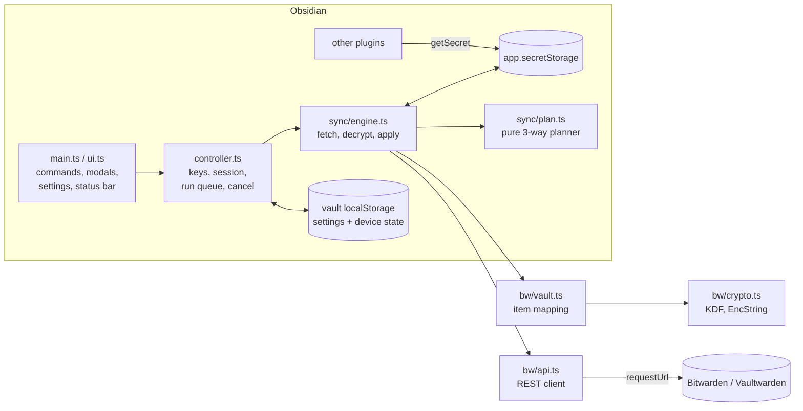

# Bitwarden Secrets for Obsidian — design and verification

This document records how the plugin works, why it is built the
way it is, and how it was verified. The user-facing summary is in
[`README.md`](../README.md).

- Plugin id `bitwarden-secrets`, version 0.1.0, `minAppVersion` 1.11.4.
- `isDesktopOnly: false`: it runs on desktop, iOS and Android.
- Runtime dependency: `hash-wasm` (Argon2id). Everything else is WebCrypto
  and the Obsidian API.
- Bundle: one 61.6 KiB `main.js` (production build). Its only import is
  `obsidian`.

## Contents

1. [Problem and approach](#1-problem-and-approach)
2. [Verified facts about Obsidian SecretStorage](#2-verified-facts-about-obsidian-secretstorage)
3. [Architecture](#3-architecture)
4. [Data model in Bitwarden](#4-data-model-in-bitwarden)
5. [Authentication, unlock and cryptography](#5-authentication-unlock-and-cryptography)
6. [The sync algorithm](#6-the-sync-algorithm)
7. [Local state and settings](#7-local-state-and-settings)
8. [User interface](#8-user-interface)
9. [Security model](#9-security-model)
10. [Verification](#10-verification)
11. [Portability](#11-portability)
12. [Performance](#12-performance)
13. [Limitations and future work](#13-limitations-and-future-work)
14. [Development guide](#14-development-guide)

---

## 1. Problem and approach

Obsidian 1.11.4 added `app.secretStorage`, a key-value store that plugins use
for API keys and tokens instead of writing them into `data.json` in clear
text. Obsidian **does not sync it between devices**: on every device, each
secret has to be typed in again.

Two ideas were considered and rejected:

- **Intercepting the OS keyring** (Secret Service on Linux, Keychain on
  macOS). On desktop, SecretStorage encrypts values with Electron
  `safeStorage`, whose key lives in the OS keyring, but the encrypted values
  stay in Obsidian's local storage. Syncing the keyring therefore syncs one
  key and no secrets. It is also impossible on iOS and Android.
- **Syncing notes through Bitwarden.** Bitwarden has item size limits,
  charges for attachments and cannot merge text. Notes belong in Obsidian
  Sync, Git or Syncthing; Bitwarden should hold only secrets.

What was chosen is **a plugin that makes one Bitwarden folder the source of
truth for SecretStorage**. It pulls items from the folder into
SecretStorage, and pushes edits and explicitly chosen secrets back.

- Other plugins need no changes: they keep calling
  `app.secretStorage.getSecret(...)`.
- The Bitwarden client logic is implemented directly on web platform APIs,
  so one code base runs on every Obsidian platform.

## 2. Verified facts about Obsidian SecretStorage

These were checked against the official typings (`obsidian@1.14.4`,
`obsidian.d.ts`) and the developer docs before any code was written:

| Fact | Source |
|---|---|
| `setSecret(id, secret): void`, `getSecret(id): string \| null`, `listSecrets(): string[]` | `obsidian.d.ts`, class `SecretStorage` (`@since 1.11.4`) |
| `id` must be *lowercase alphanumeric with optional dashes*; `setSecret` throws otherwise | `obsidian.d.ts` doc comment |
| There is **no delete method** | `obsidian.d.ts` |
| `SecretStorage extends Events`, but no events are documented | `obsidian.d.ts` |
| Values are "stored in local storage, keyed to the specific vault" and are **not synced** | docs.obsidian.md, *Secret storage* guide |
| Reported: vault-scoped on desktop, but **shared across vaults on mobile** | Obsidian forum report (Aug 2026), no staff reply |
| `app.loadLocalStorage(key)` / `app.saveLocalStorage(key, data)`: vault-specific, device-local (`@since 1.8.7`) | `obsidian.d.ts` |
| `requestUrl({ url, method, headers, body, throw })` is not subject to CORS | `obsidian.d.ts` |
| `Plugin.settings` is declared since 1.13.0, so subclasses must use `override` | `obsidian.d.ts` (it showed up as a TS4114 error) |

How these facts shaped the design:

- Missing ids are never read as deletions, because absence cannot be told
  apart from "new device".
- Remote deletions clear the value to `""`, since there is no delete method.
- Sync state lives in `loadLocalStorage`, not in `data.json`.

## 3. Architecture



| Module | Responsibility | Depends on `obsidian`? |
|---|---|---|
| `src/bw/encoding.ts` | base64 and UTF-8 without `Buffer` | no |
| `src/bw/crypto.ts` | PBKDF2/Argon2id, HKDF-Expand, `SymmetricKey`, EncString type 2, `ValueFingerprinter` | no |
| `src/bw/http.ts` | `HttpClient` abstraction (`requestUrl` in the plugin, `fetch` in tests) | no |
| `src/bw/api.ts` | URL resolution, prelogin, API-key login, sync, folder and item writes, error shaping | no |
| `src/bw/vault.ts` | Unlock, folder lookup, `readFolder`, request builders, scopes | no |
| `src/sync/plan.ts` | Pure three-way reconciliation: no I/O, deterministic | no |
| `src/sync/engine.ts` | One sync run: passes, safety guards, applying actions | no |
| `src/sync/state.ts` | Per-device state type, validation, reset | no |
| `src/controller.ts` | Session and keys, API-key origin binding, run queue, cancellation on lock | no |
| `src/settings.ts` | Settings type, defaults, strict parsing | no |
| `src/main.ts`, `src/ui.ts` | Obsidian glue: commands, timers, modals, settings tab | yes |

Everything except `main.ts` and `ui.ts` can be imported without Obsidian.
That is what lets the same code run under Node, in WebKit and Chromium, and
against a real server in the tests.

## 4. Data model in Bitwarden

The plugin only looks at **one folder** (default name `obsidian`). Items
elsewhere in the vault are never decrypted; only folder *names* are
decrypted, to find the folder.

| Bitwarden | Obsidian secret |
|---|---|
| Item type **Login** (1) | value = `login.password` |
| Item type **Secure note** (2) | value = `notes` |
| Custom field `obsidian-id` | secret id (falls back to the item name) |
| Custom field `obsidian-scope` | `global` (default), `vault:<vault name>`, `device:<device id>` |
| Item name | label shown in the conflict dialog |
| Anything else (username, URIs, other fields, attachments, unknown properties) | untouched, preserved on edit |

Rules:

- **Ids** must match `^[a-z0-9]+(?:-[a-z0-9]+)*$`, the same rule as
  `setSecret`. Other items in the folder are skipped and reported.
- **Reserved ids** start with `bitwarden-secrets-`. The plugin keeps its own
  credentials under that prefix, so Bitwarden items with such an id are
  ignored and can never overwrite them.
- **Duplicates**: if two items carry the same id, the newest `revisionDate`
  wins and the other is reported.
- **Excluded items**: organization items, trashed items (`deletedDate`) and
  other item types (cards, identities, SSH keys).
- **New uploads** are secure notes holding the `obsidian-id` field, plus
  `obsidian-scope` when it is not global. A new folder is created on the
  first upload if none exists.
- **Edits** start from the item exactly as the server sent it and remove
  only response-only metadata (`id`, `revisionDate`, `creationDate`,
  `deletedDate`, `object`, `edit`, `viewPassword`, `permissions`,
  `collectionIds`, `attachments`, `organizationUseTotp`, `data`). Then they:
  - replace the value;
  - for logins, prepend the old password to `passwordHistory` (at most 5)
    and set `passwordRevisionDate`;
  - always send `passwordHistory` back, because the server replaces the
    history with whatever the request carries;
  - send `lastKnownRevisionDate`, so the server rejects the edit if the item
    changed elsewhere in the meantime;
  - send `encryptedFor` (the account id from the last sync). Vaultwarden
    1.37 refuses writes without it; bitwarden.com treats it as optional.

## 5. Authentication, unlock and cryptography

### Login

The plugin logs in with the **personal API key**: `client_credentials`,
`scope=api`, `deviceType=21` (SDK), plus a stable `deviceIdentifier`. This
avoids two-factor prompts and new-device email verification, which would be
impractical on mobile.

The API key only *authenticates*. **Decryption still needs the master
password**, which never leaves the device: no password-derived value is
sent anywhere, and a test asserts this on the wire.

### Unlock

```
prelogin(email)            → KDF type and parameters (range-checked)
masterKey = PBKDF2-SHA256(password, lower(trim(email)), iterations)
          | Argon2id(password, SHA-256(lower(trim(email))), m, t, p)
stretched = HKDF-Expand(masterKey, "enc") ‖ HKDF-Expand(masterKey, "mac")
userKey   = decrypt(sync.profile.key, stretched)       (64 bytes: enc ‖ mac)
itemKey   = decrypt(cipher.key, userKey)                if the item has its own key
```

### Ciphertexts (`crypto.ts`)

- Only **EncString type 2** is accepted: AES-256-CBC + HMAC-SHA256,
  encrypt-then-MAC, in the format `2.iv|ct|mac`.
  - Types 0 and 1 (unauthenticated) are refused.
  - Type 7 (COSE) is refused with a dedicated message.
- The parser checks that the IV is 16 bytes, the MAC 32 bytes and the
  ciphertext a non-empty multiple of 16.
- The MAC is verified with `subtle.verify` (constant time) **before**
  AES-CBC decryption, so the padding oracle cannot be reached.
- Every encryption uses a fresh random IV.
- **KDF bounds:**
  - PBKDF2: 5,000–2,000,000 iterations.
  - Argon2id: 2–10 iterations, 16–1024 MiB, 1–16 lanes.
  - The lower bounds stop a server from downgrading the KDF. The upper
    bounds stop it from freezing the device.
- Keys are imported as non-extractable CryptoKeys. The raw copy is kept
  only to support "remember on this device", and it is zeroed on wipe
  (best effort: JavaScript strings cannot be wiped).

### Value fingerprints

To notice local edits without storing values, the plugin keeps
`HMAC-SHA256(K, id ‖ 0x00 ‖ value)`, where
`K = HKDF-Expand(userKey.mac, "obsidian-bitwarden-secrets:value-fingerprint")`.

- Without the user key it reveals nothing, unlike a plain hash, which could
  be brute-forced for low-entropy secrets.
- Binding the id means equal values under different ids do not look equal.

## 6. The sync algorithm

### 6.1 Three-way plan (`plan.ts`)

For every id in *remote ∪ base ∪ pending uploads*, with **R** = Bitwarden,
**B** = the state after the last sync on this device (base), and **L** =
SecretStorage on this device:

| R | B | L | Action |
|---|---|---|---|
| present | – | missing or equal to R | `pull` (or `adopt` if equal) |
| present | – | different, never synced | conflict `local-unsynced`, **always asked, whatever the policy** |
| present | present | missing | `pull` (restore; never a deletion) |
| value unchanged (revision may differ) | present | unchanged | nothing, or `adopt` to refresh the revision |
| value changed | present | unchanged | `pull` |
| value unchanged | present | changed | `push` |
| value changed | present | changed to the same value | `adopt` |
| value changed | present | changed differently | conflict `both-changed` → policy / user |
| gone | present | unchanged | `clear-local` (set to `""`) |
| gone | present | changed | conflict `deleted-remotely` → policy / user |
| gone | present | missing | `forget` |
| – | – | present, queued for upload | `create` |

Notes on the table:

- "Changed" on the remote side compares **value fingerprints and the cipher
  id**, not revision dates. Edits to other parts of an item (name, favorite,
  folder) bump the revision without touching the secret, and must not be
  read as a value change.
- **Conflict policy**: `ask` (default), `prefer-remote` or `prefer-local`.
- **Overrides**: choices made in the conflict dialog carry the conflict
  *kind* they were made for. If the conflict changed kind in the meantime
  (for example from both-changed to deleted-remotely), the choice is ignored
  and the user is asked again.
- The planner sorts ids, so plans are deterministic.

### 6.2 Executing a run (`engine.ts`)

1. **Fetch**: `GET /api/sync` once per pass.
2. **Folder**:
   - Find every folder with the configured name.
   - Prefer the one this device synced from before.
   - If there is no previous one, pick the lowest id, so all devices
     converge on the same folder.
   - Abort if the folder vanished, or was replaced by another one, while a
     base exists.
3. **Read** the folder, decrypting only its items. The engine also records
   the set of **every live item id in the folder**, readable or not.
4. **Hold unreadable items.** A base entry whose cipher is still in the
   folder but can no longer be used is kept and reported, not cleared.
   Causes include a newer format, a rename to an invalid id, a move to an
   organization, or a scope change.
5. **Mass-clear guard**: if more than one secret, and more than half of the
   base, would be cleared in one pass, the run aborts. This covers a wrong
   folder or account, a half-finished migration, or a hostile server.
6. **Plan**, then apply action by action, persisting state after each one.
7. **Check for races.**
   - Before `pull` or `clear-local`, the engine re-reads SecretStorage. If
     the value changed since the pass started (a local edit while network
     calls were in flight), it skips the action and runs another pass.
   - A `push` rejected as out of date (another device edited the item)
     also triggers another pass.
   - At most 3 passes per run.
8. **Cancellation**: `lock()` bumps a generation counter. The engine checks
   it between steps and stops, and a failure caused by the wiped key is
   reported as "locked", not as an error.

### 6.3 Runs and concurrency (`controller.ts`)

- One run at a time. A `sync()` call made during a run is **queued** behind
  it, not merged into it. Uploads queued and conflict choices made during a
  run are therefore applied by the next run, never dropped. Several calls
  made during the same run share one queued run.
- **One live `DeviceState` object** per controller. `queueUpload` and the
  engine mutate the same object, so concurrent writes cannot overwrite each
  other. `resetState()` refuses to run while a sync is in progress.

### 6.4 Triggers (`main.ts`)

- After unlocking.
- On the **Sync now** command and on a status bar click.
- Every `syncIntervalMinutes` (default 10).
- When Obsidian becomes visible again (`visibilitychange`): desktop focus,
  mobile resume.

## 7. Local state and settings

Everything device-specific lives in the vault's **localStorage on this
device** (`app.saveLocalStorage`):

| Key | Content |
|---|---|
| `bitwarden-secrets:settings` | server URL, email, folder name, conflict policy, remember key, sync interval, auto-lock |
| `bitwarden-secrets:state` | `deviceId`, `folderId`, `base` (per id: `cipherId`, `revisionDate`, `fingerprint`, `scope`), pending uploads and their scopes |

`data.json` is not used. It is routinely synced (Obsidian Sync, iCloud) or
committed to Git. The audit showed that if `serverUrl` lived there, anyone
who can edit the file could redirect the API key to their own server; and a
synced base state would make a fresh device believe its empty secrets had
been deleted or edited.

Both values are parsed strictly (`parseSettings`, `parseDeviceState`).
Malformed content falls back to defaults, but the device id is kept.

The plugin's own credentials live in SecretStorage under the reserved
prefix:

| SecretStorage id | Content |
|---|---|
| `bitwarden-secrets-client-id` / `-client-secret` | personal API key |
| `bitwarden-secrets-api-origin` | identity origin the API key was entered for |
| `bitwarden-secrets-user-key` | base64 user key, only when **Remember unlock on this device** is on |

## 8. User interface

- **Commands**:
  - *Unlock*, *Lock*, *Sync now*;
  - *Upload a secret to Bitwarden…*: pick a local secret, then its scope
    (every vault, this vault, this device);
  - *Resolve conflicts…*.
- **Status bar** (desktop): 🔒 locked, ✓ synced, ⟳ syncing, ⚠ error or
  conflicts. Clicking it unlocks, resolves conflicts or syncs. Mobile has no
  status bar, so it uses Notices instead.
- **Unlock modal**: a password field. The input is cleared as soon as it is
  submitted, and errors show in place.
- **Conflict modal**: values are never displayed, only the id, the label and
  the kind of conflict. For each conflict the user picks "Use Bitwarden" or
  "Use this device" ("Clear on this device" or "Upload again" for remote
  deletions), or "Decide later".
- **Settings tab**: account (server, email, API key), sync (folder,
  interval, conflict policy), security (remember unlock, auto-lock), and
  actions (lock/unlock, sync, reset sync state; the device id is shown).

## 9. Security model

### 9.1 What is protected, and against whom

| Asset | Protection |
|---|---|
| Master password | Used only locally for the KDF; never sent, never stored |
| User key | In memory while unlocked; optionally in SecretStorage (opt-in, with an explicit warning) |
| Secret values on the wire | Only Bitwarden ciphertext leaves the device |
| API key | Stored in SecretStorage; sent only to the identity origin it was entered for; `https` required except on loopback |
| Local edits | Never silently overwritten (race re-check, `local-unsynced` always asked, conflict choices tied to the conflict kind) |
| Local secrets in general | Mass-clear guard, folder-loss and folder-swap guards; unreadable items are held, not cleared |

### 9.2 Security review

An independent review of the code found 13 confirmed issues, plus
speculative and informational notes. All confirmed issues of medium or high
severity were fixed, each with a regression test (`test/sync.test.ts`,
*audit regressions*):

| # | Severity | Finding | Fix |
|---|---|---|---|
| 1 | High | `data.json` (often synced) controlled `serverUrl`, so an attacker able to edit it could have the API key posted to their server | Settings moved to device-local storage; API key bound to its origin |
| 2 | High | The remembered key and API key unlock the **whole** vault, and every plugin can read SecretStorage | Settings text states the real scope; the feature stays opt-in |
| 3 | Medium | An item that became unreadable looked deleted, and was cleared locally | Every item still present in the folder is tracked; such base entries are held |
| 4 | Medium | `prefer-local` could push a never-synced, unrelated local value over Bitwarden | `local-unsynced` is always asked, whatever the policy |
| 5 | Medium | Separate state copies: an upload queued during a sync could be lost | One live state; calls made during a run are queued behind it |
| 6 | Medium-low | Re-uploading a deleted secret lost its scope | Scope stored in the base and reused |
| 7 | Medium-low | A local edit made during a sync could be overwritten | Re-check before `pull`/`clear-local`, then another pass |
| 8 | Low | Conflict choices could apply to a conflict that had changed | Overrides carry the conflict kind |
| 9 | Low | Duplicate folder names caused a permanent abort | All matches are considered; the known folder is preferred |
| 10 | Low | The remembered key was not verified when the account has no private key | Without something to verify it against, the password is required |
| 11 | Low | A server-set Argon2 cost could freeze a phone | Bounded (≤ 1 GiB); still on the main thread (see limitations) |
| 12 | Low | Locking did not stop a running sync | Generation counter, checked between steps |
| 13 | Low | Server error text was shown verbatim | Clipped to 200 characters and prefixed `server says:` |

Static analysis:

- **semgrep** (`p/typescript`, `p/javascript`, `p/secrets`) is clean. Its
  only earlier finding was a false positive on a method then called
  `createCipher`, which looked like Node's crypto API; the method is now
  `createItem`.
- **npm audit** reports 0 vulnerabilities in runtime dependencies. All
  findings are in the dev-only `@bitwarden/cli`, which serves as a test
  counterpart.

### 9.3 Residual risks, by design

- **SecretStorage has no per-plugin isolation.** Every installed plugin can
  read every secret, including this plugin's credentials. That is a
  property of Obsidian, not of this plugin.
- **A malicious server** cannot forge ciphertext. It can still:
  - withhold items, which the mass-clear guard limits;
  - roll back to old values;
  - move other personal items into the folder, because `folderId` is not
    encrypted and is not bound to the ciphertext.
- **Redirects**: `requestUrl` gives no control over redirects. A 307/308 to
  another host could carry the token request body. (The companion `bwss`
  Secret Service daemon, which lives in a separate repository, disables
  redirects for this reason.)

## 10. Verification

| Suite | Command | Result |
|---|---|---|
| Typecheck | `npm run typecheck` (TypeScript 7, strict, `noUncheckedIndexedAccess`) | clean |
| Unit and multi-device sync (in-memory Bitwarden) | `npm test` | **68 passed** |
| Same suites in WebKit and Chromium | `npm run test:browser` | **136 passed** (68 × 2) |
| Real server + independent clients | `npm run test:integration` | **7 passed** |
| Performance budgets | `npm run perf`, `npm run perf:browser` | **5 + 10 passed** |
| Bundle portability gate | `npm run check:bundle` | only `obsidian` is required, no Node globals |

### 10.1 Known-answer vectors

`test/fixtures/gen_vectors.py` is an **independent Python implementation**
(`cryptography`, `argon2-cffi`). It produces the PBKDF2 (600,000 iterations)
and Argon2id (64 MiB, t=3, p=4) master keys, the stretched keys, the master
password hash, a protected user key, and EncStrings of edge-case plaintexts
(empty, one byte, exactly one block, Vietnamese with emoji, 1,000 bytes). The
TypeScript code must reproduce them exactly. The companion Rust `bwss`
daemon uses the same vectors.

### 10.2 Simulated Bitwarden

`test/helpers/fakeServer.ts` is an in-memory server that behaves like the
real one where it matters:

- server-assigned ids and revision dates;
- rejection of out-of-date edits;
- soft delete;
- the `encryptedFor` requirement;
- PascalCase responses, which exercise key normalisation.

Tests run two or more "devices" against it, covering:

- upload on A, delivery to B, edit on B, delivery back to A;
- idempotence, and uploading only what was explicitly queued;
- items created by other clients, including per-item keys and logins;
- edits that preserve the rest of the item, plus password history;
- conflicts and per-secret resolution; retry after a concurrent edit;
- remote deletion; folder-loss and mass-clear guards;
- vault and device scopes; reserved ids;
- tampered ciphertext and invalid ids; duplicate ids;
- a queued run during a running sync;
- state that stays per device;
- unlock with Argon2id, a wrong password, a wrong API key, the remembered
  key, and a stale remembered key;
- the 11 audit regressions.

### 10.3 Against a real server, cross-checked with independent clients

The setup:

- **Vaultwarden 1.37.4** in Docker (`vaultwarden/server:latest`). Tests
  create throwaway accounts through Vaultwarden's two-step registration,
  generating keys client-side with the plugin's own crypto, including an
  RSA key pair.
- **rbw 1.15** (Rust) as an independent *reader*. It reads the item the
  plugin wrote.
- **Official Bitwarden CLI 2026.10.0** as an independent *reader and
  writer*. Behind a throwaway TLS proxy (the CLI refuses plain http), it:
  - creates a login with URIs and a foreign custom field; the plugin reads
    it, rotates the password, and the CLI then sees the new password with
    username, URIs, notes and the foreign field intact, and the old password
    in its history;
  - reads a note the plugin created, including its scope field, edits it,
    and the plugin pulls the edit.
- **Real revision checking**: device A pushes with a stale revision after
  device B's edit; Vaultwarden rejects it, and the plugin re-plans and
  reports the conflict.
- An **Argon2id account** unlocks and uploads.

Problems this phase found, all fixed:

1. Vaultwarden 1.37 requires `encryptedFor` on item writes, returning 422
   "missing field" otherwise. rbw 1.15 has the same problem, so it is used
   only as a reader.
2. Registration moved to `register/send-verification-email` followed by
   `register/finish`.
3. The login rate limit (HTTP 429) needs to be relaxed in the test
   container.
4. The official CLI demands https, hence the TLS proxy. The proxy also had
   to be driven asynchronously, because a blocking `execFileSync` froze the
   event loop it runs on.

## 11. Portability

Obsidian mobile is a Capacitor app: WKWebView on iOS, the system WebView on
Android. It has no Node.js. The plugin relies only on:

| API | Used for | Notes |
|---|---|---|
| `crypto.subtle` (PBKDF2, HKDF via HMAC, AES-CBC, HMAC) | all crypto | secure context, which Obsidian provides |
| `crypto.getRandomValues`, `crypto.randomUUID` | IVs, device id | `randomUUID`: iOS 15.4+, Chromium 92+ |
| `WebAssembly` | Argon2id (`hash-wasm`) | 16–1024 MiB linear memory |
| `TextEncoder`/`TextDecoder`, `atob`/`btoa` | encoding | no `Buffer` |
| `requestUrl` | HTTP | bypasses CORS on mobile |
| `app.saveLocalStorage` / `loadLocalStorage` | settings, state | device-local |

How this is enforced:

- esbuild bundles with `platform: "browser"`, so any import of a Node
  built-in fails the build.
- `scripts/check-bundle.mjs` rejects a bundle that requires anything but
  `obsidian` or touches `Buffer`, `process`, `__dirname`, `eval` or
  `new Function`.
- The whole unit suite runs in **WebKit 27.2** and **Chromium** through
  Playwright. They are the closest stand-ins for Obsidian iOS and Android
  that can be automated; they are not the Obsidian apps themselves.

## 12. Performance

These are the budgets (`test/perf/perf.test.ts`) and the timings measured on
the development Mac:

| Operation | Budget | Node | WebKit | Chromium |
|---|---|---|---|---|
| PBKDF2-SHA256, 600,000 iterations | 3,000 ms | 45 ms | 85 ms | 43 ms |
| Argon2id 64 MiB, t=3, p=4 | 5,000 ms | 111 ms | 109 ms | 121 ms |
| Decrypt a 1,000-secret folder in a 5,000-item vault | 3,000 ms | 52 ms | 99 ms | 12 ms |
| Plan 10,000 secrets | 500 ms | 2.6 ms | 2.0 ms | 2.8 ms |
| First sync of 200 secrets (end to end) | 3,000 ms | 27 ms | 46 ms | 12 ms |
| No-op sync of 200 secrets | 2,000 ms | 21 ms | 39 ms | 6 ms |

Phones are typically 3–10× slower than this machine, which still leaves
every operation well inside its budget. Unlock time is dominated by the KDF
the account uses, and every later sync costs one `GET /api/sync`. The
budgets catch order-of-magnitude regressions, not noise.

## 13. Limitations and future work

- **Unsupported item formats**: organization items and COSE (type 7) items
  are skipped and held, never cleared.
- **Mobile vault isolation**: if mobile SecretStorage is indeed app-wide, a
  `vault:` scope cannot isolate secrets between vaults there.
- **Argon2 on the main thread**: a very expensive Argon2 setting can freeze
  a phone during unlock. A Worker with a timeout would fix it.
- **Deletion**: there is no delete API, so remote deletions become empty
  values.
- **Real-time updates**: the plugin polls; Bitwarden's SignalR hub is not
  used yet.
- **Testing on devices**: testing inside the real Obsidian mobile apps is
  still manual. The Playwright engines are stand-ins.
- **Plugin review**: before a community-plugin submission, run Obsidian's
  ESLint plugin (`eslint-plugin-obsidianmd`), which is not set up yet.

## 14. Development guide

```sh
npm install
npm run build              # typecheck + production main.js
npm run check:bundle
npm test                   # unit + multi-device
npm run test:browser       # needs: npx playwright install chromium webkit
npm run perf && npm run perf:browser

docker run -d --rm --name bw-secrets-it -p 127.0.0.1:18080:80 \
  -e SIGNUPS_ALLOWED=true -e SIGNUPS_VERIFY=false \
  -e LOGIN_RATELIMIT_MAX_BURST=1000 -e LOGIN_RATELIMIT_SECONDS=1 \
  -e I_REALLY_WANT_VOLATILE_STORAGE=true vaultwarden/server:latest
BW_IT_URL=http://127.0.0.1:18080 npm run test:integration
docker stop bw-secrets-it
```

To install it manually in a vault, copy `main.js` and `manifest.json` into
`<vault>/.obsidian/plugins/bitwarden-secrets/` and enable the plugin in
*Settings → Community plugins*.
