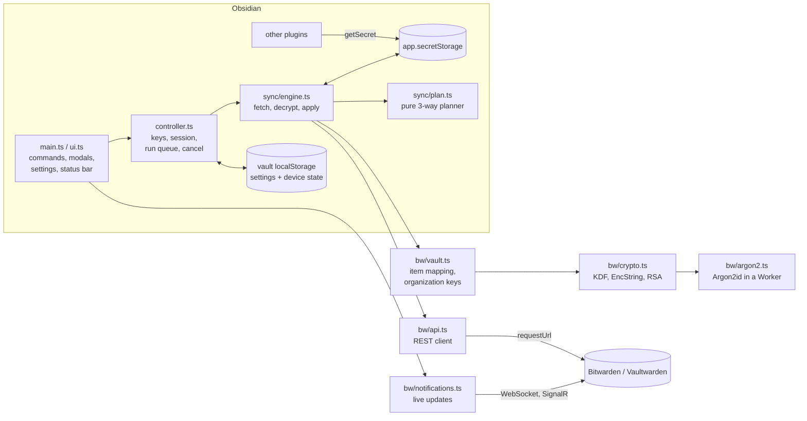

# Keychain Bitwarden for Obsidian — design and verification

This document records how the plugin works, why it is built the
way it is, and how it was verified. The user-facing summary is in
[`README.md`](../README.md).

- Follows the **dybw data model, version 1.1** (namespace `obsidian`), shared
  with bwss and the other dybw tools in the `dybw` umbrella repository
  (`docs/data-model.md`).
- Plugin id `keychain-bitwarden`, version 0.1.0, `minAppVersion` 1.11.4.
- `isDesktopOnly: false`: it runs on desktop, iOS and Android.
- Runtime dependencies: `hash-wasm` (Argon2id) and `@noble/ciphers`
  (XChaCha20-Poly1305). Everything else is WebCrypto, Web Workers, WebSocket
  and the Obsidian API.
- Bundle: one 125.6 KiB `main.js` (production build), with the Argon2
  worker embedded in it. Its only import is `obsidian`.

## Contents

1. [Problem and approach](#1-problem-and-approach)
2. [Verified facts about Obsidian SecretStorage](#2-verified-facts-about-obsidian-secretstorage)
3. [Architecture](#3-architecture)
4. [Data model in Bitwarden](#4-data-model-in-bitwarden)
5. [Authentication, unlock and cryptography](#5-authentication-unlock-and-cryptography)
6. [The sync algorithm](#6-the-sync-algorithm)
7. [Local state and settings](#7-local-state-and-settings)
8. [User interface](#8-user-interface)
9. [Security model](#9-security-model)
10. [Verification](#10-verification)
11. [Portability](#11-portability)
12. [Performance](#12-performance)
13. [Limitations and future work](#13-limitations-and-future-work)
14. [Development guide](#14-development-guide)

---

## 1. Problem and approach

Obsidian 1.11.4 added `app.secretStorage`, a key-value store that plugins use
for API keys and tokens instead of writing them into `data.json` in clear
text. Obsidian **does not sync it between devices**: on every device, each
secret has to be typed in again.

Two ideas were considered and rejected:

- **Intercepting the OS keyring** (Secret Service on Linux, Keychain on
  macOS). On desktop, SecretStorage encrypts values with Electron
  `safeStorage`, whose key lives in the OS keyring, but the encrypted values
  stay in Obsidian's local storage. Syncing the keyring therefore syncs one
  key and no secrets. It is also impossible on iOS and Android.
- **Syncing notes through Bitwarden.** Bitwarden has item size limits,
  charges for attachments and cannot merge text. Notes belong in Obsidian
  Sync, Git or Syncthing; Bitwarden should hold only secrets.

What was chosen is **a plugin that makes the marked items of a Bitwarden
vault the source of truth for SecretStorage**. An item is marked by a
custom field `obsidian:id`, wherever it is filed. The plugin pulls marked
items into SecretStorage, and pushes edits and explicitly chosen secrets
back.

- Other plugins need no changes: they keep calling
  `app.secretStorage.getSecret(...)`.
- The Bitwarden client logic is implemented directly on web platform APIs,
  so one code base runs on every Obsidian platform.

## 2. Verified facts about Obsidian SecretStorage

These were checked against the official typings (`obsidian@1.14.4`,
`obsidian.d.ts`) and the developer docs before any code was written:

| Fact | Source |
|---|---|
| `setSecret(id, secret): void`, `getSecret(id): string \| null`, `listSecrets(): string[]` | `obsidian.d.ts`, class `SecretStorage` (`@since 1.11.4`) |
| `id` must be *lowercase alphanumeric with optional dashes*; `setSecret` throws otherwise | `obsidian.d.ts` doc comment |
| There is **no delete method** | `obsidian.d.ts` |
| `SecretStorage extends Events`, but no events are documented | `obsidian.d.ts` |
| Values are "stored in local storage, keyed to the specific vault" and are **not synced** | docs.obsidian.md, *Secret storage* guide |
| Reported: vault-scoped on desktop, but **shared across vaults on mobile** | Obsidian forum report (Aug 2026), no staff reply |
| `app.loadLocalStorage(key)` / `app.saveLocalStorage(key, data)`: vault-specific, device-local (`@since 1.8.7`) | `obsidian.d.ts` |
| `requestUrl({ url, method, headers, body, throw })` is not subject to CORS | `obsidian.d.ts` |
| `Plugin.settings` is declared since 1.13.0, so subclasses must use `override` | `obsidian.d.ts` (it showed up as a TS4114 error) |

How these facts shaped the design:

- Missing ids are never read as deletions, because absence cannot be told
  apart from "new device".
- Remote deletions clear the value to `""`, since there is no delete method.
- Sync state lives in `loadLocalStorage`, not in `data.json`.

## 3. Architecture



| Module | Responsibility | Depends on `obsidian`? |
|---|---|---|
| `src/bw/encoding.ts` | base64 and UTF-8 without `Buffer` | no |
| `src/bw/crypto.ts` | PBKDF2/Argon2id, HKDF-Expand, `SymmetricKey` (legacy and COSE), EncString types 2 and 7, key wrapping, RSA-OAEP organization keys, `ValueFingerprinter` | no |
| `src/bw/cose.ts`, `src/bw/cbor.ts`, `src/bw/aead.ts` | COSE_Key and COSE_Encrypt0 as the SDK defines them; a bounded CBOR codec; XAES-256-GCM (WebCrypto) and XChaCha20-Poly1305 (`@noble/ciphers`) | no |
| `src/bw/argon2.ts`, `src/bw/argon2.worker.ts` | Argon2id runners: in a Worker (cancellable, with a timeout) or on the calling thread | no |
| `src/bw/msgpack.ts` | Bounds-checked MessagePack decoder and SignalR framing | no |
| `src/bw/notifications.ts` | Notifications hub client: handshake, pings, reconnect, coalescing | no |
| `src/bw/http.ts` | `HttpClient` abstraction (`requestUrl` in the plugin, `fetch` in tests) | no |
| `src/bw/api.ts` | URL resolution, prelogin, API-key login, sync, folder and item writes, error shaping | no |
| `src/bw/vault.ts` | Unlock, organization keys, folder lookup, `readVault`, request builders, scopes | no |
| `src/sync/plan.ts` | Pure three-way reconciliation: no I/O, deterministic | no |
| `src/sync/engine.ts` | One sync run: passes, safety guards, applying actions | no |
| `src/sync/state.ts` | Per-device state type, validation, reset | no |
| `src/controller.ts` | Session and keys, API-key origin binding, run queue, cancellation on lock | no |
| `src/settings.ts` | Settings type, defaults, strict parsing | no |
| `src/main.ts`, `src/ui.ts` | Obsidian glue: commands, timers, modals, settings tab | yes |

Everything except `main.ts` and `ui.ts` can be imported without Obsidian.
That is what lets the same code run under Node, in WebKit and Chromium, and
against a real server in the tests.

## 4. Data model in Bitwarden

The plugin scans the **whole vault**, folders play no part. To find the
marked items it decrypts the custom field *names* of every item it holds a
key for (unwrapping per-item keys where needed); the name, value, notes and
field values of an item are decrypted only once it carries `obsidian:id`.
Folder names are decrypted only to find the folder for uploads.

| Bitwarden | Obsidian secret |
|---|---|
| Custom field `obsidian:id` | **required**: marks the item and gives the secret id |
| Custom field `obsidian:password` | value, when present (any field type; hidden is usual) |
| Custom field `obsidian:location` = `notes` | otherwise value = `notes`, which the plugin filled because the value did not fit a field |
| Item type **Login** (1) | otherwise value = `login.password` |
| Item type **Secure note** (2) | otherwise value = `notes` |
| Custom field `obsidian:scope` | `global` (default), `vault:<vault name>`, `device:<device id>` |
| Item name | label shown in the conflict dialog |
| Anything else (username, URIs, other fields, attachments, unknown properties) | untouched, preserved on edit |

Rules:

- **Ids** must match `^[a-z0-9]+(?:-[a-z0-9]+)*$`, the same rule as
  `setSecret`. A marked item with another id is skipped and reported.
  Unmarked items are ignored without a report. If an item has the same
  `obsidian:*` field twice, the first one counts.
- **Reserved ids** start with `keychain-bitwarden-`. The plugin keeps its own
  credentials under that prefix, so Bitwarden items with such an id are
  ignored and can never overwrite them. The plugin's former prefix,
  `bitwarden-secrets-`, stays reserved too: secret storage cannot delete, so
  credentials saved before the rename remain on the device.
- **Duplicates**: if two items carry the same id, a personal item wins over
  an organization item, then the oldest `creationDate`, then the lowest
  cipher id. The others are reported. Creation dates never change, so every
  device keeps choosing the same item however the items are edited (the
  usual cause is "Clone item", which copies the marker). This is the rule of
  the shared dybw data model.
- **Organization items** are read only when *Sync organization items* is
  on. They are decrypted with their organization's key, items the user may
  not edit (`edit: false`) are only pulled, and items whose password the
  organization hides (`viewPassword: false`) are skipped.
- **Organization claims**: an organization item whose id is new to this
  device, or that replaces the item an id was synced with, is *claiming*
  the id. Unless the id is entirely new to this device (no base entry and
  no local value), the conflict `organization-claim` is always asked,
  whatever the policy, even when the values match: taking the item binds
  the id to it, and later local edits would then go to its members. "Keep mine" creates a personal item
  (which then wins); a push only ever goes to the organization item that
  the base entry already names, and the engine refuses anything else.
- **First push to an organization item**: a binding made by a pull,
  whether the id was new to the device or the user confirmed a claim, is
  pull-only. The first push to the item is the conflict `organization-push`,
  always asked whatever the policy, naming the organization. "Send mine"
  pushes and stores `pushConfirmed` in the base entry, which later pushes
  and pulls of the same cipher keep; any other cipher starts without it.
  The engine refuses a push to an organization item that has neither the
  stored confirmation nor the one just given. A read-only item is reported
  as not uploaded instead of asked. Base entries written before this rule
  have no confirmation, so their first push asks once.
- **Encoding**: secret storage holds text only, so the plugin does not
  implement the data model's `obsidian:encoding`. An item that sets it is
  skipped and reported, never misread; a secret already synced from it is
  held. This also covers base64 claimed on a login's own password, which
  the data model forbids (dybw ADR 0005). An unknown `obsidian:location`
  value is skipped the same way.
- **Sizes** (data model §6.4): Bitwarden takes at most 5,000 encrypted
  characters in a field value or login password and 10,000 in the notes.
  The plugin checks the encrypted length before every write, so an
  oversize value fails on the device with a message that never contains it,
  and the item is not touched:
  - a value in `obsidian:password` that no longer fits moves into the notes
    with `obsidian:location=notes`, when the notes are empty or already
    marked that way; every `obsidian:password` field is then removed, so a
    duplicate cannot become the value source. Otherwise the write fails:
    the notes hold the user's own text. Only the value `notes` marks them;
    an empty or blank `obsidian:location` claims nothing;
  - a value in `obsidian:password` that still fits, on an item whose notes
    are marked `obsidian:location=notes`, clears those notes and the mark:
    they can only hold an older copy of the secret;
  - a new upload that does not fit a field is created with the value in its
    (empty) notes and `obsidian:location=notes`;
  - a value already in the notes stays there, even when it shrinks;
  - a login password over 5,000, or notes over 10,000, fail.
  A failed upload stays queued and is retried on the next sync.
- **Excluded items**: unmarked items, trashed items (`deletedDate`), other
  item types (cards, identities, SSH keys; reported when marked), and
  organization items unless enabled (not decrypted, so not reported).
- **New uploads** are secure notes with empty notes, holding the
  `obsidian:id` field, the value in a hidden `obsidian:password` field, plus
  `obsidian:scope` when it is not global. A new secret never goes into the
  user's own password or notes. They are filed in the *Folder for
  uploads* setting (default `obsidian`; empty means no folder). Among folders
  of that name the lowest id is used, so all devices agree; one is created
  if none exists.
- **Edits** start from the item exactly as the server sent it and remove
  only response-only metadata (`id`, `revisionDate`, `creationDate`,
  `deletedDate`, `object`, `edit`, `viewPassword`, `permissions`,
  `collectionIds`, `attachments`, `organizationUseTotp`, `data`). Then they:
  - replace the value where it was read from. In an `obsidian:password`
    field only that field's value changes, and the login password and its
    history are left alone;
  - otherwise, for logins, prepend the old password to `passwordHistory` (at most 5)
    and set `passwordRevisionDate`;
  - always send `passwordHistory` back, because the server replaces the
    history with whatever the request carries;
  - send `lastKnownRevisionDate`, so the server rejects the edit if the item
    changed elsewhere in the meantime;
  - send `encryptedFor` (the account id from the last sync). Vaultwarden
    1.37 refuses writes without it; bitwarden.com treats it as optional;
  - keep `organizationId`: an edit never moves an item in or out of its
    organization, and its collections are untouched.

## 5. Authentication, unlock and cryptography

### Login

The plugin logs in with the **personal API key**: `client_credentials`,
`scope=api`, `deviceType=21` (SDK), plus a stable `deviceIdentifier`. This
avoids two-factor prompts and new-device email verification, which would be
impractical on mobile.

The API key only *authenticates*. **Decryption still needs the master
password**, which never leaves the device: no password-derived value is
sent anywhere, and a test asserts this on the wire.

### Unlock

```
prelogin(email)            → KDF type and parameters (range-checked)
masterKey = PBKDF2-SHA256(password, lower(trim(email)), iterations)
          | Argon2id(password, SHA-256(lower(trim(email))), m, t, p)
stretched = HKDF-Expand(masterKey, "enc") ‖ HKDF-Expand(masterKey, "mac")
userKey   = decrypt(sync.profile.key, stretched)       (64 bytes: enc ‖ mac)
private   = decrypt(sync.profile.privateKey, userKey)  (PKCS#8, only for organizations)
orgKey    = RSA-OAEP-decrypt(organization.key, private) (type 4: SHA-1, type 3: SHA-256)
itemKey   = decrypt(cipher.key, userKey or orgKey)      if the item has its own key
```

### Argon2id off the main thread (`argon2.ts`)

Bitwarden lets an account ask for up to 1 GiB and 10 iterations. On a phone
that can take long enough to freeze Obsidian, so the plugin derives the key
in a **Web Worker**:

- The worker is bundled on its own (`scripts/argon2-worker.mjs`) and
  embedded in `main.js` as text, because a plugin ships as one file. It is
  started from a Blob URL, one worker per derivation.
- The password is copied into the worker and the copy on the main thread is
  zeroed; the worker zeroes its copy when done.
- Closing the unlock dialog, or locking, aborts the derivation: the worker is
  terminated mid-computation. A derivation still running after **two
  minutes** is stopped with an explanation.
- A lock that arrives while the key is being derived wins: the derived key
  is wiped instead of unlocking.
- When a worker cannot be started at all, the derivation falls back to the
  main thread, where it can be neither aborted nor timed out. The fallback
  therefore refuses an Argon2 memory above 128 MiB (twice Bitwarden's
  default) with an explanation, instead of freezing Obsidian.

### Ciphertexts (`crypto.ts`)

- Two authenticated EncString types are accepted, each only with its own
  kind of key:
  - **Type 2**: AES-256-CBC + HMAC-SHA256, encrypt-then-MAC, in the format
    `2.iv|ct|mac`, with a legacy 64-byte key.
  - **Type 7**: a COSE_Encrypt0, with a COSE key (see below).
  - Types 0 and 1 (unauthenticated) are refused.
  - For organization keys only RSA-OAEP types 3 and 4 are accepted; the
    RSA+HMAC types 5 and 6 are refused.
- The parser checks that the IV is 16 bytes, the MAC 32 bytes and the
  ciphertext a non-empty multiple of 16.
- The MAC is verified with `subtle.verify` (constant time) **before**
  AES-CBC decryption, so the padding oracle cannot be reached.
- Every encryption uses a fresh random IV.
- **KDF bounds:**
  - PBKDF2: 5,000–2,000,000 iterations.
  - Argon2id: 2–10 iterations, 16–1024 MiB, 1–16 lanes.
  - The lower bounds stop a server from downgrading the KDF. The upper
    bounds stop it from freezing the device.
- Keys are imported as non-extractable CryptoKeys. The raw copy is kept
  only to support "remember on this device", and it is zeroed on wipe
  (best effort: JavaScript strings cannot be wiped).

### The newer ("v2") encryption: COSE keys and EncString type 7

Accounts created or upgraded on Bitwarden's newer encryption have a COSE
user key. Everything follows Bitwarden's SDK (`bitwarden-crypto`):

- **Keys**: a symmetric COSE_Key (`kty` 4) with a 16-byte `kid`, `key_ops`,
  a 32-byte `k`, and `alg` -70010 (XAES-256-GCM, what new accounts get) or
  -70000 (XChaCha20-Poly1305). In Bitwarden's byte format a key of exactly
  64 bytes is a legacy key; a longer one is a COSE_Key padded to at least
  65 bytes (the last N bytes hold N). Shorter keys are refused.
- **User key**: still wrapped with the stretched master key as type 2; the
  plaintext is the padded COSE_Key.
- **Type 7** is `7.` + base64 of an untagged COSE_Encrypt0: a protected
  header with `alg`, `kid` and a content type; the 24-byte nonce in the
  unprotected `iv`; the ciphertext with its 16-byte tag. The associated data
  is the COSE `Enc_structure` over the exact protected header bytes.
- **Checks on decryption**: `alg` must be the key's, `kid` must be the
  key's, `crit` is refused, and the content type must be what the caller
  expects: `utf8` (padded to 32-byte blocks) for strings, `legacy-key` or
  `cose-key` for wrapped keys, `pkcs8` for the private key. A string cannot
  be read as a key or the other way around. `key_ops` is honoured.
- **Item keys** are still legacy 64-byte keys; wrapped with a COSE user key
  they are type 7 with content type `legacy-key`, and the item's fields
  remain type 2.
- **Encryption** uses the key's own type, so edits and uploads on a v2
  account are type 7, with the same headers and padding as the SDK.
- **Newer sync responses** carry the user key in
  `userDecryption.masterPasswordUnlock` together with the master key's
  **salt**, which may differ from the email, and the private key in
  `profile.accountKeys`. Both shapes are read; the salt is used when given.

### Value fingerprints

To notice local edits without storing values, the plugin keeps
`HMAC-SHA256(K, id ‖ 0x00 ‖ value)`, where
`K = HKDF-Expand(userKey.mac, "obsidian-keychain-bitwarden:value-fingerprint")`.

- Without the user key it reveals nothing, unlike a plain hash, which could
  be brute-forced for low-entropy secrets.
- Binding the id means equal values under different ids do not look equal.

## 6. The sync algorithm

### 6.1 Three-way plan (`plan.ts`)

For every id in *remote ∪ base ∪ pending uploads*, with **R** = Bitwarden,
**B** = the state after the last sync on this device (base), and **L** =
SecretStorage on this device:

| R | B | L | Action |
|---|---|---|---|
| present | – | missing or equal to R | `pull` (or `adopt` if equal) |
| present | – | different, never synced | conflict `local-unsynced`, **always asked, whatever the policy** |
| present | present | missing | `pull` (restore; never a deletion) |
| value unchanged (revision may differ) | present | unchanged | nothing, or `adopt` to refresh the revision |
| value changed | present | unchanged | `pull` |
| value unchanged | present | changed | `push` |
| value changed | present | changed to the same value | `adopt` |
| value changed | present | changed differently | conflict `both-changed` → policy / user |
| gone | present | unchanged | `clear-local` (set to `""`) |
| gone | present | changed | conflict `deleted-remotely` → policy / user |
| gone | present | missing | `forget` |
| – | – | present, queued for upload | `create` |
| organization item, cipher ≠ base | present, or – | present, or missing with a base | conflict `organization-claim`, **always asked**; "keep mine" = `create` a personal item |
| organization item, cipher = base, no `pushConfirmed` | present | changed | conflict `organization-push`, **always asked**; "send mine" = `push` and remember |

Notes on the table:

- "Changed" on the remote side compares **value fingerprints and the cipher
  id**, not revision dates. Edits to other parts of an item (name, favorite,
  folder) bump the revision without touching the secret, and must not be
  read as a value change.
- **Conflict policy**: `ask` (default), `prefer-remote` or `prefer-local`.
- **Overrides**: choices made in the conflict dialog carry the conflict
  *kind* they were made for. If the conflict changed kind in the meantime
  (for example from both-changed to deleted-remotely), the choice is ignored
  and the user is asked again.
- The planner sorts ids, so plans are deterministic.

### 6.2 Executing a run (`engine.ts`)

1. **Fetch**: `GET /api/sync` once per pass.
2. **Read** the marked items of the whole vault. The engine also records
   the set of live items that are **marked, or could not be inspected**
   (undecryptable fields, organization items without a key or with
   organizations off): an item it cannot look into might still be marked.
3. **Hold unreadable items.** A base entry whose cipher is still in that
   set but can no longer be used is kept and reported, not cleared. Causes
   include a newer format, a rename to an invalid id, a move to an
   organization, or a scope change. An item whose `obsidian:id` field was
   removed is readable and unmarked, so it counts as deleted.
4. **Mass-clear guard**: if more than one secret, and more than half of the
   base, would be cleared in one pass, the run aborts. This covers a wrong
   account, a half-finished migration, or a hostile server.
5. **Plan**, then apply action by action, persisting state after each one.
6. **Check for races.**
   - Before `pull` or `clear-local`, the engine re-reads SecretStorage. If
     the value changed since the pass started (a local edit while network
     calls were in flight), it skips the action and runs another pass.
   - A `push` rejected as out of date (another device edited the item)
     also triggers another pass.
   - At most 3 passes per run.
7. **Cancellation**: `lock()` bumps a generation counter. The engine checks
   it between steps and stops, and a failure caused by the wiped key is
   reported as "locked", not as an error.

### 6.3 Runs and concurrency (`controller.ts`)

- One run at a time. A `sync()` call made during a run is **queued** behind
  it, not merged into it. Uploads queued and conflict choices made during a
  run are therefore applied by the next run, never dropped. Several calls
  made during the same run share one queued run.
- **One live `DeviceState` object** per controller. `queueUpload` and the
  engine mutate the same object, so concurrent writes cannot overwrite each
  other. `resetState()` refuses to run while a sync is in progress.

### 6.4 Triggers (`main.ts`)

- After unlocking.
- When the **notifications hub** announces a change (see 6.5).
- On the **Sync now** command and on a status bar click.
- Every `syncIntervalMinutes` (default 10), as a fallback.
- When Obsidian becomes visible again (`visibilitychange`): desktop focus,
  mobile resume. The hub reconnects at the same moment.

### 6.5 Live updates (`notifications.ts`)

While unlocked and with *Live updates* on (the default), the plugin keeps a
WebSocket to the server's notifications hub, as the official clients do:

- **Endpoint**: `wss://notifications.bitwarden.com/hub`,
  `wss://notifications.bitwarden.eu/hub`, or `<server>/notifications/hub`
  for self-hosted servers, authenticated with the API session's access token
  in the query string.
- **Protocol**: SignalR with the MessagePack protocol, the only one
  Vaultwarden speaks. The handshake is
  `{"protocol":"messagepack","version":1}` followed by `0x1e`; messages are
  VarInt-length-prefixed MessagePack arrays. The client pings every 15
  seconds and reconnects if nothing arrives for 60 seconds.
- **What counts**: `ReceiveMessage` invocations whose `Type` is a vault
  change (cipher or folder created, updated or deleted, full vault sync,
  organization keys). A notification whose `ContextId` is this device's own
  identifier is ignored: it reports a change this device made.
- **Coalescing**: notifications only trigger a regular sync. A burst is
  reported once, after 1 second of quiet, and at most every 5 seconds.
- **Reconnects** back off from 2 seconds to 5 minutes, reset after each
  successful handshake. Callbacks of a replaced socket are ignored.
- **Untrusted input**: the MessagePack decoder bounds-checks every read,
  limits nesting to 32 levels and messages to 1 MiB, rejects invalid UTF-8,
  and builds maps without a prototype. Malformed data closes the connection
  and starts over.

## 7. Local state and settings

Everything device-specific lives in the vault's **localStorage on this
device** (`app.saveLocalStorage`):

| Key | Content |
|---|---|
| `keychain-bitwarden:settings` | server URL, email, folder for uploads, conflict policy, organization items, live updates, remember key, sync interval, auto-lock |
| `keychain-bitwarden:state` | `deviceId`, `base` (per id: `cipherId`, `revisionDate`, `fingerprint`, `scope`), pending uploads and their scopes |

`data.json` is not used. It is routinely synced (Obsidian Sync, iCloud) or
committed to Git. The audit showed that if `serverUrl` lived there, anyone
who can edit the file could redirect the API key to their own server; and a
synced base state would make a fresh device believe its empty secrets had
been deleted or edited.

Both values are parsed strictly (`parseSettings`, `parseDeviceState`).
Malformed content falls back to defaults, but the device id is kept.

The plugin's own credentials live in SecretStorage under the reserved
prefix:

| SecretStorage id | Content |
|---|---|
| `keychain-bitwarden-client-id` / `-client-secret` | personal API key |
| `keychain-bitwarden-api-origin` | identity origin the API key was entered for |
| `keychain-bitwarden-user-key` | base64 user key, only when **Remember unlock on this device** is on |

## 8. User interface

- **Commands**:
  - *Unlock*, *Lock*, *Sync now*;
  - *Upload a secret to Bitwarden…*: pick a local secret, then its scope
    (every vault, this vault, this device);
  - *Resolve conflicts…*.
- **Status bar** (desktop): 🔒 locked, ✓ synced, ⟳ syncing, ⚠ error or
  conflicts. Clicking it unlocks, resolves conflicts or syncs. Mobile has no
  status bar, so it uses Notices instead.
- **Unlock modal**: a password field. The input is cleared as soon as it is
  submitted, and errors show in place. Closing it while unlocking cancels
  the key derivation.
- **Conflict modal**: values are never displayed, only the id, the label and
  the kind of conflict. For each conflict the user picks "Use Bitwarden" or
  "Use this device" ("Clear on this device" or "Upload again" for remote
  deletions), or "Decide later".
- **Settings tab**: account (server, email, API key), sync (folder for uploads, live
  updates, interval, conflict policy, organization items), security
  (remember unlock, auto-lock), and actions (lock/unlock, sync, reset sync
  state; the device id is shown).

## 9. Security model

### 9.1 What is protected, and against whom

| Asset | Protection |
|---|---|
| Master password | Used only locally for the KDF; never sent, never stored |
| User key | In memory while unlocked; optionally in SecretStorage (opt-in, with an explicit warning) |
| Secret values on the wire | Only Bitwarden ciphertext leaves the device |
| API key | Stored in SecretStorage; sent only to the identity origin it was entered for; `https` required except on loopback |
| Local edits | Never silently overwritten (race re-check, `local-unsynced` always asked, conflict choices tied to the conflict kind) |
| Local secrets in general | Mass-clear guard; unreadable items are held, not cleared |
| Personal secrets vs. organization items | Organization items are opt-in and never take over a personal item's id |
| The app's responsiveness | Argon2id in a terminable worker; notifications coalesced and spaced out |

### 9.2 Security review

An independent review of the code found 13 confirmed issues, plus
speculative and informational notes. All confirmed issues of medium or high
severity were fixed, each with a regression test (`test/sync.test.ts`,
*audit regressions*):

| # | Severity | Finding | Fix |
|---|---|---|---|
| 1 | High | `data.json` (often synced) controlled `serverUrl`, so an attacker able to edit it could have the API key posted to their server | Settings moved to device-local storage; API key bound to its origin |
| 2 | High | The remembered key and API key unlock the **whole** vault, and every plugin can read SecretStorage | Settings text states the real scope; the feature stays opt-in |
| 3 | Medium | An item that became unreadable looked deleted, and was cleared locally | Every marked or uninspectable item is tracked; such base entries are held |
| 4 | Medium | `prefer-local` could push a never-synced, unrelated local value over Bitwarden | `local-unsynced` is always asked, whatever the policy |
| 5 | Medium | Separate state copies: an upload queued during a sync could be lost | One live state; calls made during a run are queued behind it |
| 6 | Medium-low | Re-uploading a deleted secret lost its scope | Scope stored in the base and reused |
| 7 | Medium-low | A local edit made during a sync could be overwritten | Re-check before `pull`/`clear-local`, then another pass |
| 8 | Low | Conflict choices could apply to a conflict that had changed | Overrides carry the conflict kind |
| 9 | Low | Duplicate folder names caused a permanent abort | Folders no longer decide what syncs; uploads use the lowest id |
| 10 | Low | The remembered key was not verified when the account has no private key | Without something to verify it against, the password is required |
| 11 | Low | A server-set Argon2 cost could freeze a phone | Bounded (≤ 1 GiB), and run in a worker that can be cancelled and times out |
| 12 | Low | Locking did not stop a running sync | Generation counter, checked between steps |
| 13 | Low | Server error text was shown verbatim | Clipped to 200 characters and prefixed `server says:` |
| 14 | High | Vault-wide scanning let any organization member claim an id: a pending upload, or a local edit after the personal item was deleted, was pushed into their item under `prefer-local` | Conflict `organization-claim`, always asked; "keep mine" creates a personal item; pushes go only to the organization item already in the base |
| 15 | Medium | An organization item replacing a deleted personal item was pulled silently | Same `organization-claim` conflict |
| 16 | Medium | Re-entering only the client id after changing the server rebound the stored client secret to the new server | Rebinding to another server clears the other part |
| 17 | Medium | An organization item holding the same value was adopted, or one replacing a synced item was pulled onto a device that had lost the value, binding the id to it without asking | `organization-claim` whenever a base entry or a local value exists, whatever the values |

Findings 14 to 17 come from a second review, after the move to vault-wide
scanning (`test/plan.test.ts`, `test/organizations.test.ts`,
`test/sync.test.ts`).

Static analysis:

- **semgrep** (`p/typescript`, `p/javascript`, `p/secrets`) is clean. Its
  only earlier finding was a false positive on a method then called
  `createCipher`, which looked like Node's crypto API; the method is now
  `createItem`.
- **npm audit** reports 0 vulnerabilities in runtime dependencies. All
  findings are in the dev-only `@bitwarden/cli`, which serves as a test
  counterpart.

### 9.3 Residual risks, by design

- **SecretStorage has no per-plugin isolation.** Every installed plugin can
  read every secret, including this plugin's credentials. That is a
  property of Obsidian, not of this plugin.
- **A malicious server** cannot forge ciphertext. It can still:
  - withhold items, which the mass-clear guard limits;
  - roll back to old values;
  - not make another personal item a secret: the `obsidian:id` marker is
    an encrypted field name, unlike the unauthenticated `folderId` an
    earlier folder-based design relied on;
  - with *Sync organization items* on, **forge an organization**: an
    organization key reaches the client RSA-encrypted to the account's
    public key, which the server knows. A hostile server, like any
    organization member with access to a collection the user sees, can
    therefore create marked organization items. They cannot replace a
    personal item's secret (personal items win) nor receive a local value
    without the user's explicit choice (`organization-claim`), but they can
    set or change secrets that only exist as organization items. Hence the
    opt-in and the settings text;
  - send notifications at will, which only cause coalesced extra syncs;
  - on a v2 account, serve an older user key from before a key rotation:
    the plugin does not check the signed "security state" the SDK uses
    against such downgrades.
- **Redirects**: `requestUrl` gives no control over redirects. A 307/308 to
  another host could carry the token request body. (The companion `bwss`
  Secret Service daemon, which lives in a separate repository, disables
  redirects for this reason.)

## 10. Verification

| Suite | Command | Result |
|---|---|---|
| Typecheck | `npm run typecheck` (TypeScript 7, strict, `noUncheckedIndexedAccess`) | clean |
| Lint (`eslint-plugin-obsidianmd`, the community review rules) | `npm run lint` | 0 errors; 3 warnings about the settings API of Obsidian 1.13, kept for `minAppVersion` 1.11.4 |
| Unit and multi-device sync (in-memory Bitwarden), every account kind | `npm test` | **350 passed**, 3 skipped (the real-worker tests, which need a browser, and the SDK check) |
| Same suites in WebKit and Chromium | `npm run test:browser` | **704 passed** (352 × 2) |
| Bitwarden's SDK decrypts what the plugin encrypted | `npm run test:sdk` (needs Rust) | **passed** |
| Real server + independent clients | `npm run test:integration` | **12 passed** |
| Performance budgets | `npm run perf`, `npm run perf:browser` | **5 + 10 passed** |
| Bundle portability gate | `npm run check:bundle` | only `obsidian` is required, no Node globals |

### 10.1 Known-answer vectors

`test/fixtures/gen_msgpack.py` encodes 46 values with the official Python
`msgpack` library (integer and string size classes, 64-bit integers beyond
2^53, floats, binary, maps and arrays at their size boundaries, the three
timestamp formats); the decoder must read them back exactly. A frame
captured from Vaultwarden 1.37.4 is decoded as well.

`test/fixtures/gen_vectors.py` is an **independent Python implementation**
(`cryptography`, `argon2-cffi`). It produces the PBKDF2 (600,000 iterations)
and Argon2id (64 MiB, t=3, p=4) master keys, the stretched keys, the master
password hash, a protected user key, and EncStrings of edge-case plaintexts
(empty, one byte, exactly one block, Vietnamese with emoji, 1,000 bytes). The
TypeScript code must reproduce them exactly. The companion Rust `bwss`
daemon uses the same vectors.

`test/fixtures/cose-vectors.json` comes from **Bitwarden's own SDK**
(`bitwarden-crypto`, pinned revision), through the Rust program in
`test/fixtures/sdk-vectors`. For an XAES-256-GCM and an XChaCha20-Poly1305
account it records the COSE user key, the user key wrapped with the master
key, strings of edge-case lengths, a legacy and a COSE item key wrapped with
the user key plus a value under each, and the wrapped private key. The
plugin must unlock the account with the password, decrypt everything, and
encode COSE keys byte for byte like the SDK. In the other direction,
`npm run test:sdk` feeds the plugin's own type 7 ciphertexts to the SDK,
which must decrypt them. XAES-256-GCM is also checked against the C2SP
test vectors.

### 10.2 Simulated Bitwarden

`test/helpers/fakeServer.ts` is an in-memory server that behaves like the
real one where it matters:

- server-assigned ids and revision dates;
- rejection of out-of-date edits;
- soft delete;
- the `encryptedFor` requirement;
- PascalCase responses, which exercise key normalisation.

The sync, organization and newer-sync-shape suites run three times: with a
legacy account key, and with XAES-256-GCM and XChaCha20-Poly1305 account
keys. Tests run two or more "devices" against it, covering:

- upload on A, delivery to B, edit on B, delivery back to A;
- idempotence, and uploading only what was explicitly queued;
- items created by other clients, including per-item keys and logins;
- edits that preserve the rest of the item, plus password history;
- conflicts and per-secret resolution; retry after a concurrent edit;
- remote deletion, a removed marker, and the mass-clear guard;
- items in any folder or none; `obsidian:password` fields on logins and
  notes, read and written in place; the folder for uploads;
- vault and device scopes; reserved ids;
- tampered ciphertext and invalid ids; duplicate ids;
- a queued run during a running sync;
- state that stays per device;
- unlock with Argon2id, a wrong password, a wrong API key, the remembered
  key, and a stale remembered key;
- the 11 audit regressions;
- organization items: opt-in, pull and push with the organization key
  (both RSA-OAEP variants), read-only and hidden-password items, personal
  items winning, unconfirmed memberships, unreadable organization keys;
- Argon2id in a worker: cancellation, timeout, worker failure, fallback,
  and the known-answer key from the worker exactly as embedded in `main.js`
  (in WebKit and Chromium);
- the notifications hub: handshake, coalescing, own-device filtering,
  pings, backoff, silence detection, malformed input, stale sockets.

### 10.3 Against a real server, cross-checked with independent clients

The setup:

- **Vaultwarden 1.37.4** in Docker (`vaultwarden/server:latest`). Tests
  create throwaway accounts through Vaultwarden's two-step registration,
  generating keys client-side with the plugin's own crypto, including an
  RSA key pair.
- **rbw 1.15** (Rust) as an independent *reader*. It reads the item the
  plugin wrote.
- **Official Bitwarden CLI 2026.10.0** as an independent *reader and
  writer*. Behind a throwaway TLS proxy (the CLI refuses plain http), it:
  - creates a login with URIs and a foreign custom field; the plugin reads
    it, rotates the password, and the CLI then sees the new password with
    username, URIs, notes and the foreign field intact, and the old password
    in its history;
  - creates a login whose `obsidian:password` hidden field holds the
    secret; the plugin reads the field, writes an edit back into it, and
    the login password stays as it was;
  - reads a note the plugin created, including its scope field, edits it,
    and the plugin pulls the edit.
- **Real revision checking**: device A pushes with a stale revision after
  device B's edit; Vaultwarden rejects it, and the plugin re-plans and
  reports the conflict.
- An **Argon2id account** unlocks and uploads.
- Accounts on the **newer encryption** (XAES-256-GCM and XChaCha20-Poly1305
  user keys): two devices upload, pull and edit, and everything the server
  stores (item names, custom fields, folder names) is type 7. The official CLI
  cannot be used here: it refuses these test accounts, which lack the
  signing keys a real v2 account also has; the SDK check above covers the
  format instead.
- An **organization**, created the way the web vault creates one, with a
  marked item in no folder: the plugin pulls it, pushes an edit
  encrypted with the organization key, and the item stays in its
  organization.
- The **notifications hub**: device B uploads, device A hears about it
  within seconds and pulls it, and B's own change is not reported back to
  B (so `ContextId` is the `deviceIdentifier` the plugin logs in with).

Problems this phase found, all fixed:

1. Vaultwarden 1.37 requires `encryptedFor` on item writes, returning 422
   "missing field" otherwise. rbw 1.15 has the same problem, so it is used
   only as a reader.
2. Registration moved to `register/send-verification-email` followed by
   `register/finish`.
3. The login rate limit (HTTP 429) needs to be relaxed in the test
   container.
4. The official CLI demands https, hence the TLS proxy. The proxy also had
   to be driven asynchronously, because a blocking `execFileSync` froze the
   event loop it runs on.
5. rbw's agent loads organization keys only when it unlocks, so after the
   organization test it could not decrypt the vault until it was locked and
   unlocked again.
6. Registering many accounts in a row eventually hits a registration rate
   limit (HTTP 429); a fresh container clears it.

## 11. Portability

Obsidian mobile is a Capacitor app: WKWebView on iOS, the system WebView on
Android. It has no Node.js. The plugin relies only on:

| API | Used for | Notes |
|---|---|---|
| `crypto.subtle` (PBKDF2, HKDF via HMAC, AES-CBC, HMAC) | all crypto | secure context, which Obsidian provides |
| `crypto.getRandomValues`, `crypto.randomUUID` | IVs, device id | `randomUUID`: iOS 15.4+, Chromium 92+ |
| `WebAssembly` | Argon2id (`hash-wasm`) | 16–1024 MiB linear memory |
| `crypto.subtle` AES-GCM, AES-CBC | XAES-256-GCM (one AES block = the first block of AES-CBC with a zero IV) | XChaCha20-Poly1305 is pure JavaScript (`@noble/ciphers`) |
| `Worker`, `Blob`, `URL.createObjectURL` | Argon2id off the main thread | falls back to the main thread when unavailable |
| `WebSocket` | live updates | the connection drops in the background on mobile; it is reopened on resume |
| `TextEncoder`/`TextDecoder`, `atob`/`btoa` | encoding | no `Buffer` |
| `requestUrl` | HTTP | bypasses CORS on mobile |
| `app.saveLocalStorage` / `loadLocalStorage` | settings, state | device-local |

How this is enforced:

- esbuild bundles with `platform: "browser"`, so any import of a Node
  built-in fails the build.
- `scripts/check-bundle.mjs` rejects a bundle that requires anything but
  `obsidian` or touches `Buffer`, `process`, `__dirname`, `eval` or
  `new Function`.
- The whole unit suite runs in **WebKit 27.2** and **Chromium** through
  Playwright, including the embedded Argon2 worker started from a Blob URL. They are the closest stand-ins for Obsidian iOS and Android
  that can be automated; they are not the Obsidian apps themselves.

## 12. Performance

These are the budgets (`test/perf/perf.test.ts`) and the timings measured on
the development Mac:

| Operation | Budget | Node | WebKit | Chromium |
|---|---|---|---|---|
| PBKDF2-SHA256, 600,000 iterations | 3,000 ms | 45 ms | 85 ms | 43 ms |
| Argon2id 64 MiB, t=3, p=4 | 5,000 ms | 111 ms | 109 ms | 121 ms |
| Find and decrypt 1,000 marked secrets in a 5,000-item vault | 3,000 ms | 172 ms | 360 ms | 47 ms |
| Plan 10,000 secrets | 500 ms | 2.6 ms | 2.0 ms | 2.8 ms |
| First sync of 200 secrets (end to end) | 3,000 ms | 27 ms | 46 ms | 12 ms |
| No-op sync of 200 secrets | 2,000 ms | 21 ms | 39 ms | 6 ms |

Phones are typically 3–10× slower than this machine, which still leaves
every operation well inside its budget. Unlock time is dominated by the KDF
the account uses, and every later sync costs one `GET /api/sync`. The
budgets catch order-of-magnitude regressions, not noise.

## 13. Limitations and future work

- **Mobile vault isolation**: if mobile SecretStorage is indeed app-wide, a
  `vault:` scope cannot isolate secrets between vaults there. That is
  Obsidian's behaviour; the plugin cannot change it.
- **Deletion**: SecretStorage has no delete API, so remote deletions become
  empty values.
- **Organization items** cannot be created from Obsidian (uploads are
  personal), and their trust model is weaker (see 9.3).
- **Settings API**: the settings tab still uses `display()`, deprecated in
  Obsidian 1.13 in favour of `getSettingDefinitions()`. Moving to it means
  raising `minAppVersion` from 1.11.4 to 1.13.0; until then the settings do
  not show up in Obsidian's settings search.
- **Testing on devices**: testing inside the real Obsidian mobile apps is
  still manual. The Playwright engines are stand-ins.

## 14. Development guide

```sh
npm install
npm run lint               # eslint-plugin-obsidianmd
npm run build              # typecheck (TypeScript 7) + production main.js with the embedded worker
npm run check:bundle
npm test                   # unit + multi-device
npm run test:browser       # needs: npx playwright install chromium webkit
npm run perf && npm run perf:browser

docker run -d --rm --name keychain-bw-it -p 127.0.0.1:18080:80 \
  -e SIGNUPS_ALLOWED=true -e SIGNUPS_VERIFY=false \
  -e LOGIN_RATELIMIT_MAX_BURST=1000 -e LOGIN_RATELIMIT_SECONDS=1 \
  -e I_REALLY_WANT_VOLATILE_STORAGE=true vaultwarden/server:latest
BW_IT_URL=http://127.0.0.1:18080 npm run test:integration
docker stop keychain-bw-it
```

To install it manually in a vault, copy `main.js` and `manifest.json` into
`<vault>/.obsidian/plugins/keychain-bitwarden/` and enable the plugin in
*Settings → Community plugins*.
